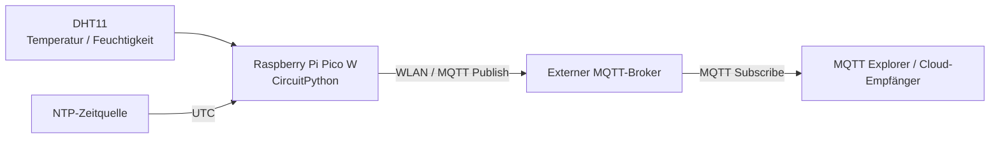

# Termin 1 – MQTT-Sensordatenübertragung mit dem Raspberry Pi Pico W

**MCI · Industrial Internet of Things · Wintersemester 2026/27**

## 1. Projektübersicht

Im ersten Termin wird ein **Raspberry Pi Pico W** als MQTT-Sensorknoten verwendet. Ein angeschlossener **DHT11-Sensor** erfasst Temperatur und relative Luftfeuchtigkeit. Die Messwerte werden in einem konfigurierbaren Intervall als JSON-Nachrichten an den MQTT-Broker des Kurses gesendet.

Zusätzlich veröffentlicht das Gerät seinen aktuellen Status (`ok` bzw. `error`). Über ein **Last Will and Testament (LWT)** kann der Broker bei einem unerwarteten Verbindungsabbruch den Status `offline` veröffentlichen.

Die Firmware wurde im weiteren Projektverlauf um einen HTTP-Server für **Termin 2 – Netzwerke** ergänzt. Die hier dokumentierten MQTT-Funktionen entsprechen dem derzeitigen Stand des bereitgestellten `code.py`; die HTTP-Schnittstelle ist nicht Schwerpunkt dieser README.

### Umgesetzte Funktionen

- WLAN-Verbindung des Pico W über CircuitPython.
- Auslesen des DHT11-Sensors (Temperatur und Luftfeuchtigkeit).
- Zeitstempel in UTC über NTP, Ausgabe im ISO-8601-Format.
- Versand der Messwerte als JSON über zwei getrennte MQTT-Topics.
- Gerätestatus auf einem eigenen MQTT-Topic (`ok`, `error`, `offline`).
- Retained Statusnachrichten und konfigurierbares MQTT-Last-Will.
- Eindeutige MQTT-Client-ID und konfigurierbares Keep-Alive.
- Wiederverbindungsversuch nach einem Fehler im MQTT-Loop.
- Trennung von allgemeinen Einstellungen und vertraulichen Zugangsdaten.

## 2. Systemarchitektur



**Datenfluss:** Der Pico liest den Sensor aus, ergänzt die Werte um Sensor-ID und UTC-Zeitstempel und veröffentlicht sie beim Broker. Andere Anwendungen können die Daten abonnieren. In **Termin 3** übernimmt ein Python-Empfänger das Speichern und Visualisieren der Messwerte.

## 3. Hardware und Software

| Bestandteil | Verwendung |
|---|---|
| Raspberry Pi Pico W | Mikrocontroller mit WLAN |
| DHT11 | Messung von Temperatur und relativer Luftfeuchtigkeit |
| CircuitPython | Laufzeitumgebung auf dem Pico W |
| `adafruit_dht` | Auslesen des DHT11 |
| `adafruit_minimqtt` | MQTT-Client und Publish-Funktionen |
| `adafruit_ntp` | UTC-Zeitsynchronisation |
| `wifi`, `socketpool`, `board` | WLAN, Sockets und GPIO-Zugriff |
| MQTT Explorer (optional) | Überprüfung der veröffentlichten MQTT-Nachrichten |

Der DHT11 ist in unserer Konfiguration mit dem **Datensignal an GP22** angeschlossen. Zusätzlich werden Versorgung und Masse benötigt; die zulässige Versorgungsspannung ist anhand der verwendeten DHT11-Modulvariante zu prüfen.

## 4. Dateien und Verzeichnisstruktur

Die folgende Struktur ist für den Git-Projektordner vorgesehen:

```text
MCI_IIoT_pico/
├── .gitignore
├── Termin_1_MQTT/
│   ├── README.md
│   ├── code.py
│   └── settings.toml
├── Termin_2_Netzwerke/
└── Termin_3_Cloud/
```

Auf dem Pico selbst werden zum Ausführen der Firmware folgende Dateien benötigt:

```text
CIRCUITPY/
├── code.py
├── settings.toml
├── Secrets.py        # nur lokal; nicht in Git!
└── lib/
    ├── adafruit_dht.mpy
    ├── adafruit_ntp.mpy
    ├── adafruit_minimqtt/
    └── ...              # weitere von den Bibliotheken benötigte Abhängigkeiten
```

Die genaue Belegung von `lib/` richtet sich nach der installierten CircuitPython-Version und den dazu passenden Adafruit-Bibliotheken. **`Secrets.py` enthält Zugangsdaten und darf nicht ins Repository aufgenommen werden.** Der im Repository abgelegte `code.py` kann auch die HTTP-Funktionen aus Termin 2 enthalten, da es sich um den später weiterentwickelten Firmwarestand handelt.

## 5. Einrichtung des Pico W

### 5.1 CircuitPython und Bibliotheken

1. Ein zur Pico-W-Hardware passendes CircuitPython installieren.
2. Den Pico per USB verbinden; das Laufwerk `CIRCUITPY` muss sichtbar sein.
3. Die zum Programm passenden CircuitPython-Bibliotheken und deren Abhängigkeiten im Verzeichnis `lib/` ablegen.
4. `code.py`, `settings.toml` und die lokale `Secrets.py` ins Hauptverzeichnis von `CIRCUITPY` kopieren.
5. Das Gerät startet `code.py` automatisch beim Start bzw. beim Speichern neu.

**Hinweis:** Die Firmware ist für **CircuitPython**, nicht für MicroPython, geschrieben.

### 5.2 Zugangsdaten in `Secrets.py`

Die lokal auf dem Pico liegende Datei `Secrets.py` muss folgende **großgeschriebene** Python-Variablen enthalten:

```python
WIFI_SSID = "MEIN_WLAN"
WIFI_PASSWORD = "MEIN_WLAN_PASSWORT"
MQTT_USERNAME = "MEIN_MQTT_BENUTZERNAME"
MQTT_PASSWORD = "MEIN_MQTT_PASSWORT"
```

Die Firmware verwendet `import Secrets` und greift beispielsweise über `Secrets.WIFI_SSID` auf diese Werte zu. **Groß- und Kleinschreibung müssen exakt übereinstimmen.** Eine `.toml`-Datei kann nicht ohne Anpassung als Python-Modul importiert werden.

### 5.3 Gerätekonfiguration in `settings.toml`

Die folgende Beispielkonfiguration entspricht den **vom aktuellen `code.py` gelesenen Schlüsseln**. Broker und Topic-Präfix sind die bisher im Projekt verwendeten Werte; für andere Geräte müssen insbesondere Geräte-ID, Client-ID und Topic-Präfix angepasst werden.

```toml
device_id = "temp-hvw-resch-jacobs-doleschel-01"
names = "hvw-resch-jacobs-doleschel"
location = "Innsbruck"

broker_address = "158.180.44.197"
broker_port = 1883
mqtt_client_id = "pico-hvw-resch-jacobs-doleschel-01"
mqtt_keep_alive = 60

telemetry_topic = "iiot/group/hvw-resch-jacobs-doleschel/sensor/temperature/state"
humidity_topic = "iiot/group/hvw-resch-jacobs-doleschel/sensor/humidity/state"
status_topic = "iiot/group/hvw-resch-jacobs-doleschel/status"

reading_interval_seconds = 1
sensor_pin = 22
sensor_type = "temperature"
sensor_unit = "°C"

status_ok = "ok"
status_error = "error"
status_offline = "offline"
status_qos = 1
status_retain = true
lwt_qos = 1
lwt_retain = true
```

Die Zugangsdaten befinden sich **nicht** in dieser Datei. `settings.toml` ist bei CircuitPython die Konfigurationsdatei im Hauptverzeichnis von `CIRCUITPY`; die Werte werden im Code über `os.getenv(...)` geladen.

**Wichtig:** Alle vom Code benötigten Schlüssel müssen vorhanden sein. Das Programm wandelt einige Werte unmittelbar mit `int(...)` oder `float(...)` um und kann beim Start abbrechen, wenn eine Einstellung fehlt oder ungültig ist.

## 6. MQTT-Kommunikation

### 6.1 Broker und Topics

Der in der Konfiguration verwendete Broker ist über `158.180.44.197:1883` erreichbar, sofern eine Netzwerkverbindung besteht und die erforderlichen Zugangsdaten gültig sind. Der Pico verwendet MQTT als **Publisher**; ein MQTT-Abonnement wird in diesem Firmwarestand nicht eingerichtet.

| Zweck | Topic |
|---|---|
| Temperatur | `iiot/group/hvw-resch-jacobs-doleschel/sensor/temperature/state` |
| Luftfeuchtigkeit | `iiot/group/hvw-resch-jacobs-doleschel/sensor/humidity/state` |
| Gerätestatus | `iiot/group/hvw-resch-jacobs-doleschel/status` |

Zum Beobachten aller drei Topics kann ein MQTT-Client z. B. folgendes Topic-Muster abonnieren:

```text
iiot/group/hvw-resch-jacobs-doleschel/#
```

### 6.2 JSON-Payload für Sensormesswerte

Temperatur und Luftfeuchtigkeit werden jeweils in einer separaten Nachricht übertragen. Die folgenden Werte sind **Beispiele für das Format**, keine protokollierten Messungen.

**Temperatur:**

```json
{
  "timestamp": "2026-11-10T12:00:00Z",
  "sensor_id": "temp-hvw-resch-jacobs-doleschel-01",
  "value": 23.0,
  "unit": "°C"
}
```

**Luftfeuchtigkeit:**

```json
{
  "timestamp": "2026-11-10T12:00:00Z",
  "sensor_id": "temp-hvw-resch-jacobs-doleschel-01",
  "value": 45,
  "unit": "%"
}
```

`timestamp` ist ein UTC-Zeitstempel im ISO-8601-Format. Das abschließende `Z` steht für UTC. `sensor_id` identifiziert das sendende Gerät.

### 6.3 Gerätestatus, Retain und Last Will

Der Gerätestatus wird unabhängig von den Messwerten veröffentlicht:

```json
{
  "status": "ok",
  "sensor_id": "temp-hvw-resch-jacobs-doleschel-01"
}
```

Es gibt drei vorgesehene Zustände:

| Status | Bedeutung |
|---|---|
| `ok` | MQTT-Verbindung hergestellt bzw. erfolgreiche Sensormessung nach einem Fehler |
| `error` | Beim Lesen des DHT11 trat ein `RuntimeError` auf |
| `offline` | Last Will des Brokers bei unerwartetem Verbindungsverlust |

Das Status-Topic wird mit **QoS 1 und Retain** konfiguriert. Dadurch kann ein neu verbundener Subscriber den zuletzt vom Broker gespeicherten Status unmittelbar erhalten.

Vor der MQTT-Verbindung registriert der Pico den `offline`-Status als **Last Will and Testament (LWT)**. Trennt sich der Client unerwartet und erkennt der Broker den Verbindungsabbruch, kann der Broker diese Nachricht selbst veröffentlichen. Beim normalen Verbindungsaufbau bzw. nach erfolgreicher Wiederverbindung sendet der Pico `ok`.

Die Messwertnachrichten werden im vorhandenen Code dagegen ohne explizite `qos`- oder `retain`-Argumente veröffentlicht; hier gelten die Standardwerte der verwendeten MiniMQTT-Bibliothek.

### 6.4 Keep-Alive und Wiederverbindung

Die MQTT-Client-ID wird über `mqtt_client_id` gesetzt. Sie sollte pro gleichzeitig verbundenem Gerät eindeutig sein, damit sich verschiedene Clients nicht gegenseitig vom Broker verdrängen.

`mqtt_keep_alive` steuert den Keep-Alive-Wert der MQTT-Verbindung. Die Hauptschleife ruft `mqtt_client.loop(timeout=1)` auf. Falls dabei ein Fehler auftritt, gibt das Programm Diagnoseinformationen aus, versucht `mqtt_client.reconnect()` und sendet nach erfolgreicher Wiederverbindung wieder `ok`.

## 7. Ablauf des Programms

1. Allgemeine Einstellungen aus `settings.toml` und Zugangsdaten aus `Secrets.py` einlesen.
2. WLAN-Verbindung aufbauen und Socket-Pool erzeugen.
3. NTP-Zeitquelle mit UTC-Offset 0 einrichten.
4. DHT11 initialisieren und MQTT-Client konfigurieren.
5. Last Will registrieren, MQTT-Verbindung herstellen und `ok` senden.
6. Wiederholt den MQTT-Loop aufrufen und im eingestellten Intervall die Sensordaten lesen.
7. Messwerte mit Zeitstempel per MQTT veröffentlichen.
8. Bei einem DHT11-Lesefehler `error` senden; nach einer späteren erfolgreichen Messung den Status wieder auf `ok` setzen.

Das Messintervall wird mit `time.monotonic()` überprüft. Die Zeitstempel der veröffentlichten Messungen stammen dagegen aus NTP (`ntp.datetime`).

## 8. Funktionstest

### 8.1 Serielle Ausgabe prüfen

Den Pico per USB mit einem seriellen Monitor (z. B. Mu oder Thonny, sofern passend für CircuitPython) öffnen. Beim Start sind Meldungen ähnlich diesen zu erwarten:

```text
Verbinde mit WLAN...
WLAN verbunden!
IP: <IP-ADRESSE>
Verbinde mit MQTT...
MQTT verbunden!
Status -> ok
Temperatur gesendet:
...
Luftfeuchtigkeit gesendet:
...
```

Die genaue IP-Adresse und die Messwerte variieren. Die Firmware gibt auch die Namen aus `Secrets.py` als Debug-Information aus, **nicht** deren Werte.

### 8.2 Nachrichten mit MQTT Explorer prüfen

1. MQTT Explorer öffnen und den in `settings.toml` angegebenen Broker und Port eintragen.
2. Mit den gültigen MQTT-Zugangsdaten verbinden.
3. Das Topic `iiot/group/hvw-resch-jacobs-doleschel/#` beobachten.
4. Kontrollieren, dass Temperatur- und Feuchtigkeitsnachrichten mit gültigem JSON ankommen.
5. Prüfen, ob auf dem Status-Topic nach Verbindungsaufbau `ok` steht.
6. Optional den Pico von der Stromversorgung trennen und nach Erkennung des Verbindungsabbruchs den `offline`-Last-Will beobachten. Die Reaktion kann vom Keep-Alive und den Broker-Einstellungen abhängen.

### 8.3 Manuelle Testübersicht

| Test | Erwartetes Ergebnis |
|---|---|
| Pico startet bei gültiger Konfiguration | WLAN und MQTT werden verbunden |
| Temperaturmessung | JSON-Nachricht auf dem Temperatur-Topic |
| Feuchtigkeitsmessung | JSON-Nachricht auf dem Feuchtigkeits-Topic |
| Status beim Verbindungsaufbau | `ok` auf dem Status-Topic |
| Sensorauslesefehler | `error` bei abgefangenem `RuntimeError` |
| Nächste erfolgreiche Messung nach Fehler | `ok` wird erneut veröffentlicht |
| Unerwarteter Verbindungsabbruch | Broker kann LWT `offline` veröffentlichen |

Die Tabelle beschreibt die erwarteten Ergebnisse zur Nachprüfung; sie ist **kein automatisch ausgeführtes Testprotokoll**.

## 9. Fehlerbehebung

| Problem | Mögliche Ursache und Prüfung |
|---|---|
| `AttributeError` bei `Secrets` | Namen in `Secrets.py` müssen genau `WIFI_SSID`, `WIFI_PASSWORD`, `MQTT_USERNAME`, `MQTT_PASSWORD` heißen. |
| `ImportError` | `Secrets.py` oder eine Adafruit-Bibliothek fehlt auf `CIRCUITPY` bzw. in `lib/`. |
| Keine WLAN-Verbindung | SSID, Passwort, Empfang und unterstütztes WLAN-Band prüfen. |
| Keine MQTT-Verbindung | Broker-Adresse, Port, Benutzername, Passwort und Netzwerkzugriff prüfen. |
| Status bleibt auf `offline` | Eindeutige `mqtt_client_id`, Keep-Alive und tatsächlichen Client-Verbindungsstatus überprüfen. |
| `DHT Fehler` in der Konsole | Verkabelung, Versorgung, Datenpin und Ausleseintervall prüfen. |
| Kein gültiger Zeitstempel | Prüfen, ob die NTP-Zeitquelle über das Netzwerk erreichbar ist. |
| Fehlende Konfiguration | Schlüsselnamen und Datentypen in `settings.toml` kontrollieren. |

## 10. Sicherheit und Git

Die Zugangsdaten dürfen nicht in `code.py`, `settings.toml`, der README oder einem Git-Commit stehen. Im übergeordneten `.gitignore` sollten mindestens folgende Einträge enthalten sein:

```gitignore
**/Secrets.py
**/secrets.py
**/.env
```

Vor einem Commit prüfen:

```powershell
git status
```

Eine `.gitignore` schützt nicht rückwirkend vor Zugangsdaten, die bereits in früheren Commits enthalten waren. In diesem Fall müssen die betroffenen Zugangsdaten ausgetauscht und die Git-Historie gesondert bereinigt werden.

**Netzwerksicherheit:** Der verwendete MQTT-Port `1883` weist auf eine übliche unverschlüsselte MQTT-Verbindung hin. Im bereitgestellten Code ist keine TLS-Konfiguration eingerichtet. Zugangsdaten und Messwerte sollten deshalb nur in einem entsprechend vertrauenswürdigen Netzwerk bzw. über vom Betreiber vorgesehene sichere Zugangswege übertragen werden.

## 11. Abgrenzung zu Termin 2 und 3

- **Termin 1 – MQTT:** Diese Dokumentation behandelt Sensorauslesung, WLAN, Zeitstempel, MQTT-Publishing, Status und Last Will.
- **Termin 2 – Netzwerke:** Dieselbe Firmware wurde um einen HTTP-Server mit `GET /`, `GET /config`, `POST /config` und `GET /status` erweitert. Diese Funktionen werden separat dokumentiert.
- **Termin 3 – Cloud:** Ein Python-MQTT-Empfänger speichert die veröffentlichten Daten in CSV und SQLite; ein Streamlit-Dashboard visualisiert sie. Die Cloud-Dienste werden über Docker Compose ausgeführt.

**Bekannte Einschränkung des aktuellen Firmwarestands:** Der Aufruf `server.poll()` liegt im vorliegenden `code.py` innerhalb des Ausnahmezweigs für MQTT-Loop-Fehler. Die HTTP-Verarbeitung ist dadurch nicht in jedem regulären Hauptschleifendurchlauf aktiv. Dieser Punkt betrifft insbesondere die Dokumentation und Tests zu Termin 2. An der Firmware wurde für diese README nichts verändert.

## 12. Referenz

- [MCI – Industrial Internet of Things: Kurs-Repository](https://github.com/jhumci/MECH-M-3-IIoT)
- [Adafruit CircuitPython](https://circuitpython.org/)

---

*Dokumentiert wird die vorhandene Firmware. Die Beispielnachrichten und Testschritte dienen der Erläuterung und sind nicht als zusätzlich implementierter Funktionsumfang zu verstehen.*
