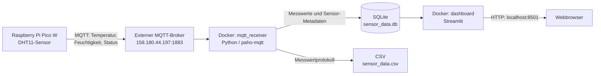

# IIoT – MQTT-Datenerfassung und Cloud-Dashboard

**MCI | Industrial Internet of Things | Termin 3 – Cloud | WS 2026/27**

Dieses Projekt erfasst Messwerte eines **Raspberry Pi Pico W** über MQTT, speichert sie auf einem Laptop in **SQLite** und **CSV** und visualisiert sie in einem **Streamlit-Dashboard**. Neue Sensoren bzw. Sensor-Kanäle werden anhand der MQTT-Topics automatisch erkannt. Der aktuelle Gerätestatus wird über separate MQTT-Statusnachrichten ausgewertet.

Die Cloud-Anwendung besteht aus zwei Docker-Compose-Diensten und lässt sich mit einem Befehl starten. Ein eigener MQTT-Broker ist **nicht** Bestandteil des Docker-Setups: Der im Kurs bereitgestellte Broker wird extern verwendet.

## 1. Funktionsumfang

- Empfang von Temperatur- und Feuchtigkeitswerten über MQTT.
- Empfang weiterer Sensoren bzw. Gruppen über MQTT-Wildcard-Topics ohne manuelles Eintragen jedes Sensors.
- Speicherung gültiger Messwerte in einer SQLite-Datenbank und zusätzlich in einer CSV-Datei.
- Automatische Registrierung erkannter Sensoren in der Datenbank.
- Übersicht über Gruppen, Geräte, Sensorkanäle und den zuletzt bekannten MQTT-Gerätestatus.
- Zeitreihendiagramme sowie aktuelle Werte, Minimum, Maximum und Mittelwert.
- Automatische Aktualisierung des Streamlit-Dashboards (ca. alle 5 Sekunden).
- Containerisierter Betrieb mit Docker Compose; persistente Daten liegen im lokalen `data/`-Ordner.

## 2. Systemarchitektur



**Datenfluss:** Der Pico W verbindet sich mit dem WLAN, liest den DHT11 aus und sendet die Werte per MQTT. Der Python-Empfänger abonniert mehrere Gruppen und Sensortypen, verarbeitet die JSON-Nachrichten und schreibt gültige Messwerte in die Datenbank. Das Dashboard liest die gespeicherten Daten und stellt sie im Browser dar.

## 3. Technologien

| Komponente | Verwendung |
|---|---|
| Raspberry Pi Pico W | WLAN-fähiger Mikrocontroller |
| DHT11 | Temperatur- und Luftfeuchtigkeitssensor an GP22 |
| CircuitPython | Firmware-/Python-Umgebung des Pico W |
| MQTT / Adafruit MiniMQTT | Datenübertragung vom Mikrocontroller |
| Python 3.12 | Laufzeit für die Docker-Anwendung |
| `paho-mqtt` | MQTT-Empfänger auf dem Laptop |
| SQLite (`sqlite3`) | Persistente Datenbank |
| CSV | Zusätzlicher Export bzw. einfaches Messwertprotokoll |
| Streamlit / pandas | Weboberfläche und Auswertung |
| Docker / Docker Compose | Start und Isolation der Cloud-Dienste |

## 4. Verzeichnisstruktur

Die nachfolgende Struktur zeigt die **Cloud-Anwendung** im Ordner `Termin_3_Cloud/` des Git-Repositories:

```text
MCI_IIoT_pico/
├── .gitignore
├── Termin_1_MQTT/
├── Termin_2_Netzwerke/          # Pico-Code und Netzwerkaufgaben
└── Termin_3_Cloud/
    ├── README.md                # Diese Dokumentation
    ├── Dockerfile
    ├── compose.yaml
    ├── .dockerignore
    ├── requirements.txt
    ├── settings.toml            # Cloud-Konfiguration ohne Passwörter
    ├── .env                     # Lokal anlegen; nicht in Git!
    ├── mqtt_receiver.py         # MQTT abonnieren und Daten speichern
    ├── dashboard.py             # Streamlit-Weboberfläche
    ├── .venv/                   # Optional für lokale Python-Ausführung
    └── data/                    # Automatisch/bei Bedarf erzeugt; nicht in Git!
        ├── sensor_data.db
        └── sensor_data.csv
```

> `data/`, `.env` und `.venv/` sind lokale Dateien bzw. Ordner und gehören **nicht** ins Git-Repository. Ein frisch geklontes Projekt hat daher zunächst noch keine Messdaten.

## 5. Voraussetzungen

Für den Betrieb des Dashboards auf dem Laptop:

- Windows, Linux oder macOS mit installiertem und laufendem **Docker Desktop** bzw. Docker Engine inklusive Docker Compose.
- Internet- bzw. Netzwerkzugriff auf den MQTT-Broker unter `158.180.44.197:1883`.
- MQTT-Benutzername und MQTT-Passwort für den Kurs-Broker.
- Ein Webbrowser für das Dashboard.

Für Messwerte vom eigenen Gerät zusätzlich:

- Raspberry Pi Pico W mit CircuitPython, passenden Adafruit-Bibliotheken und dem Projektcode auf dem Laufwerk `CIRCUITPY`.
- DHT11-Sensor, angeschlossen an **GP22** (entsprechend der verwendeten Pico-Konfiguration).
- WLAN-Zugangsdaten für ein Netzwerk, das der Pico verwenden kann.

## 6. Pico W vorbereiten

Der Pico W wird unabhängig von Docker konfiguriert. Auf dem Laufwerk `CIRCUITPY` liegen mindestens `code.py`, `settings.toml`, die benötigten Bibliotheken in `lib/` und eine **lokale** Datei `Secrets.py`.

### 6.1 Zugangsdaten in `Secrets.py`

Die Datei `Secrets.py` enthält Python-Zuweisungen mit **großgeschriebenen** Variablennamen:

```python
WIFI_SSID = "MEIN_WLAN"
WIFI_PASSWORD = "MEIN_WLAN_PASSWORT"
MQTT_USERNAME = "MEIN_MQTT_BENUTZERNAME"
MQTT_PASSWORD = "MEIN_MQTT_PASSWORT"
```

Die Datei `code.py` verwendet dazu:

```python
import Secrets

WIFI_SSID = Secrets.WIFI_SSID
WIFI_PASSWORD = Secrets.WIFI_PASSWORD
MQTT_USER = Secrets.MQTT_USERNAME
MQTT_PASSWORD = Secrets.MQTT_PASSWORD
```

**Wichtig:** Die Schreibweise muss übereinstimmen; CircuitPython/Python unterscheidet Groß- und Kleinschreibung. `Secrets.py` darf wegen der Zugangsdaten **nicht in Git committed** werden. Falls die Datei in einem lokalen Projektordner liegt, muss sie von `.gitignore` erfasst werden.

### 6.2 Geräteeinstellungen in `settings.toml`

Die vorhandene Pico-Konfiguration enthält unter anderem folgende Werte (Ausschnitt, weitere Parameter können vorhanden sein):

```toml
device_id = "temp-hvw-resch-jacobs-doleschel-01"
names = "hvw-resch-jacobs-doleschel"
location = "Innsbruck"

broker_address = "158.180.44.197"
broker_port = 1883
mqtt_keep_alive = 60

telemetry_topic = "iiot/group/hvw-resch-jacobs-doleschel/sensor/temperature/state"
humidity_topic = "iiot/group/hvw-resch-jacobs-doleschel/sensor/humidity/state"
status_topic = "iiot/group/hvw-resch-jacobs-doleschel/status"

reading_interval_seconds = 1
sensor_pin = 22
sensor_unit = "°C"
```

Die Werte können an das eigene Gerät bzw. die eigene Gruppe angepasst werden. `settings.toml` auf dem Pico ist **nicht identisch** mit der nachfolgend beschriebenen Cloud-`settings.toml`.

### 6.3 Pico starten und prüfen

1. `code.py`, `settings.toml`, `Secrets.py` und die benötigten Bibliotheken auf `CIRCUITPY` bereitstellen.
2. Pico neu starten (bzw. `code.py` speichern, um den Auto-Reload auszulösen).
3. Über die serielle Konsole prüfen, ob WLAN- und MQTT-Verbindung hergestellt werden.
4. Kontrollieren, ob Temperatur-, Feuchtigkeits- und Statusmeldungen beim Broker ankommen.

Die Pico-Anwendung bietet zusätzlich eine lokale HTTP-API (`/`, `/config`, `/status`), die nur innerhalb des erreichbaren lokalen Netzwerks zugänglich ist. Für die Geräteübersicht des Cloud-Dashboards wird **das MQTT-Statustopic** verwendet, nicht der HTTP-Endpunkt.

## 7. Cloud-Anwendung konfigurieren

Alle folgenden Befehle werden **im Ordner `Termin_3_Cloud`** ausgeführt.

### 7.1 `.env` erstellen

Lege im gleichen Ordner wie `compose.yaml` die Datei `.env` an:

```dotenv
MQTT_USERNAME=MEIN_MQTT_BENUTZERNAME
MQTT_PASSWORD=MEIN_MQTT_PASSWORT
```

Die Werte durch die eigenen Zugangsdaten ersetzen. **Die `.env` niemals veröffentlichen oder in Git aufnehmen.** Die Datei wird über `env_file` an den MQTT-Empfänger übergeben; sie wird nicht in das Docker-Image kopiert.

### 7.2 Cloud-`settings.toml`

Die Cloud-Konfiguration sieht folgendermaßen aus:

```toml
[mqtt]
broker_address = "158.180.44.197"
broker_port = 1883
keep_alive = 60
telemetry_topic = "iiot/group/+/sensor/+/state"
status_topic = "iiot/group/+/status"

[storage]
csv_file = "data/sensor_data.csv"
database_file = "data/sensor_data.db"

[dashboard]
port = 8501
```

Das `+` ist ein MQTT-Wildcard-Zeichen für **genau eine Ebene**. Dadurch können Nachrichten unterschiedlicher Gruppen und Sensortypen empfangen werden, ohne jeden Sensor vorher konfigurieren zu müssen.

### 7.3 Git-Schutz für lokale Dateien

Die `.gitignore` im Repository-Stamm sollte mindestens Folgendes enthalten:

```gitignore
**/.env
**/Secrets.py
**/secrets.py
**/.venv/
**/__pycache__/
**/.pytest_cache/
*.pyc
*.db
*.sqlite3
*.csv
**/data/
```

`Dockerfile`, `compose.yaml`, `.dockerignore`, `requirements.txt`, Python-Code und **passwortfreie** `settings.toml` sollen dagegen versioniert werden. Bereits früher von Git erfasste Geheimnisse werden durch eine spätere `.gitignore` **nicht** rückwirkend aus der Git-Historie entfernt.

## 8. Cloud-System mit Docker Compose starten

### 8.1 Konfiguration prüfen

Unter Windows PowerShell **aus dem Repository-Hauptverzeichnis**:

```powershell
cd .\Termin_3_Cloud
docker compose -f .\compose.yaml config --quiet
```

Unter Linux/macOS entsprechend in den Ordner `Termin_3_Cloud` wechseln und `docker compose config --quiet` ausführen.

Wenn der Befehl **keine Ausgabe** liefert, ist die Compose-Konfiguration syntaktisch gültig. Die `.env` muss zu diesem Zeitpunkt vorhanden sein.

### 8.2 Container bauen und starten

```powershell
docker compose up -d --build
```

- `--build`: Erstellt die Images aus dem `Dockerfile` neu.
- `-d`: Startet die Dienste im Hintergrund.

Compose startet zwei Dienste:

| Dienst | Aufgabe | Port |
|---|---|---|
| `mqtt_receiver` | MQTT abonnieren, Nachrichten validieren, CSV und SQLite schreiben | Kein Host-Port benötigt |
| `dashboard` | Datenbank auslesen und Streamlit-Oberfläche bereitstellen | `127.0.0.1:8501` |

Das Host-Verzeichnis `./data` wird in **beiden** Containern unter `/app/data` eingebunden. So können die Daten unabhängig vom Container-Lebenszyklus bestehen bleiben.

### 8.3 Status und Logs prüfen

```powershell
docker compose ps
docker compose logs --tail=50 mqtt_receiver
docker compose logs --tail=50 dashboard
```

Die Statusausgabe sollte für beide Dienste `Up` anzeigen. In den MQTT-Logs sollten nach erfolgreicher Verbindung eingehende bzw. gespeicherte Nachrichten erscheinen. Die Log-Anzeige kann live verfolgt werden:

```powershell
docker compose logs -f mqtt_receiver
```

`Strg + C` beendet nur die Log-Anzeige, **nicht** die bereits im Hintergrund laufenden Container.

### 8.4 Dashboard öffnen

Im Browser auf demselben Laptop:

**http://localhost:8501**

Der Port ist absichtlich an `127.0.0.1` gebunden; das Dashboard wird dadurch standardmäßig **nicht im lokalen Netz freigegeben**.

### 8.5 Container stoppen und neu starten

```powershell
# Stoppen und Container entfernen; Daten im Host-Ordner bleiben bestehen
docker compose down

# Wieder starten
docker compose up -d

# Nach Änderungen an Dockerfile oder requirements.txt neu bauen
docker compose up -d --build
```

## 9. MQTT-Topics und Nachrichten

Der MQTT-Empfänger abonniert diese Topics:

| Topic-Filter | Zweck |
|---|---|
| `iiot/group/+/sensor/+/state` | Messwerte verschiedener Gruppen und Sensortypen |
| `iiot/group/+/status` | MQTT-Gerätestatus pro Gruppe |

**Beispiel-Topics der eigenen Gruppe:**

```text
iiot/group/hvw-resch-jacobs-doleschel/sensor/temperature/state
iiot/group/hvw-resch-jacobs-doleschel/sensor/humidity/state
iiot/group/hvw-resch-jacobs-doleschel/status
```

Messwerte werden als JSON übertragen und vom Empfänger geprüft. Aus dem MQTT-Topic werden unter anderem Gruppenname und Sensortyp bestimmt. Ungültige JSON-Nachrichten und nicht unterstützte Formate sollen protokolliert bzw. übersprungen werden, ohne den Empfänger zu beenden.

Eine gültige Statusnachricht kann beispielsweise so aussehen:

```json
{"status": "ok"}
```

Für Statusmeldungen werden die Zustände `ok`, `error` und `offline` verwendet. Der Pico verwendet für den Verbindungsverlust eine MQTT-Last-Will-Nachricht (LWT); der zuletzt bekannte Status kann vom Broker als Retained Message bereitgestellt werden. **Ein gespeicherter Status ist nicht automatisch ein Beweis für eine derzeit aktive Verbindung.** Das Dashboard berücksichtigt deshalb zusätzlich die letzte Messwertaktivität.

## 10. Datenhaltung

Der Empfänger speichert Messwerte in `data/sensor_data.db` und protokolliert sie zusätzlich in `data/sensor_data.csv`.

### SQLite-Tabellen

**`measurements`** – Messwerte:

| Spalte | Beschreibung |
|---|---|
| `id` | Fortlaufender Primärschlüssel |
| `timestamp` | Zeitstempel des Empfangs (UTC) |
| `sensor_id` | Kennung des Sensors/Geräts |
| `sensor_type` | Sensortyp (z. B. `temperature`, `humidity`) |
| `value` | Numerischer Messwert |
| `unit` | Einheit |

**`sensors`** – automatisch erkannte Sensorkanäle:

| Spalte | Beschreibung |
|---|---|
| `group_name` | MQTT-Gruppe |
| `sensor_id` | Sensor-/Gerätekennung |
| `sensor_type` | Sensortyp |
| `unit` | Einheit |
| `first_seen` | Erstmalige Erkennung |
| `last_seen` | Letzter empfangener Messwert |

**`group_status`** – zuletzt bekannte Statusmeldung:

| Spalte | Beschreibung |
|---|---|
| `group_name` | MQTT-Gruppe |
| `sensor_id` | Gemeldete Gerätekennung |
| `status` | Letzter Status |
| `last_status_at` | Empfangszeitpunkt der Statusmeldung |

**Hinweis zur aktuellen Datenstruktur:** In `measurements` wird der Gruppenname derzeit nicht als eigene Spalte gespeichert. Falls zwei Gruppen dieselbe `sensor_id` verwenden, können Messwerte bei einer rein ID-basierten Auswertung nicht eindeutig auseinandergehalten werden. Für den produktiven Mehrgruppenbetrieb sollte die Kombination aus Gruppe, Geräte-ID und Sensortyp eindeutig in den Messwerten referenziert werden.

### Datenpersistenz

Das Compose-Setup verwendet einen **Bind Mount**:

```yaml
volumes:
  - ./data:/app/data
```

Die Messwerte bleiben beim Stoppen, Neubauen oder Ersetzen der Container auf dem Laptop gespeichert. Vor dem Verschieben oder Kopieren der SQLite-Datei sollte der MQTT-Empfänger gestoppt werden, damit eine konsistente Sicherung entsteht.

## 11. Dashboard-Funktionen

Das Streamlit-Dashboard zeigt:

- Gruppen-, Geräte- und Sensorkanalübersicht.
- Aktuellen bzw. zuletzt bekannten MQTT-Gerätestatus und Zeitpunkt der letzten Messwertaktivität.
- Filter nach Gruppe, Gerät und Sensortyp.
- Zeitreihendiagramm der Messwerte.
- Letzten Messwert sowie Mittelwert, Minimum und Maximum.
- Tabelle mit aufgezeichneten Messwerten.
- Automatische Aktualisierung ungefähr alle fünf Sekunden und eine manuelle Aktualisierungsmöglichkeit.

Bei der Statusbewertung werden MQTT-Status und Zeit seit dem letzten Messwert miteinander abgeglichen. Dadurch kann die Oberfläche z. B. auf veraltete Messwerte oder widersprüchliche Online-/Offline-Informationen hinweisen. Die derzeitige Aktivitätsschwelle liegt bei ungefähr **30 Sekunden**.

## 12. Optional: Ohne Docker lokal ausführen

Für Entwicklung und Fehlersuche können MQTT-Empfänger und Dashboard auch direkt mit Python gestartet werden. Python 3.12 wird empfohlen.

Unter Windows PowerShell im Ordner `Termin_3_Cloud`:

```powershell
python -m venv .venv
.\.venv\Scripts\python.exe -m pip install -r requirements.txt
```

Danach **zwei getrennte Terminals** verwenden:

```powershell
# Terminal 1: MQTT-Empfänger
.\.venv\Scripts\python.exe mqtt_receiver.py
```

```powershell
# Terminal 2: Dashboard
.\.venv\Scripts\python.exe -m streamlit run dashboard.py
```

Nicht gleichzeitig die lokale und die Docker-basierte Version des MQTT-Empfängers betreiben, da sonst Messwerte doppelt gespeichert werden können. Ebenso darf Port 8501 nicht bereits durch eine zweite Streamlit-Instanz belegt sein.

## 13. Funktionsprüfung

| Test | Erwartetes Ergebnis |
|---|---|
| `docker compose config --quiet` | Keine Fehlermeldung |
| `docker compose up -d --build` | Beide Dienste starten |
| `docker compose ps` | `mqtt_receiver` und `dashboard` sind `Up` |
| Pico sendet Messwerte | MQTT-Logs zeigen eingehende/gespeicherte Daten |
| `data/sensor_data.db` vorhanden | Neue Messwerte werden persistiert |
| `http://localhost:8501` öffnen | Dashboard lädt |
| Messwerte ändern sich | Diagramm und Kennzahlen aktualisieren sich |
| Weiteren Sensor / andere Gruppe senden lassen | Neuer Sensorkanal wird automatisch erkannt |
| Pico-Verbindung unterbrechen | Status-/Aktivitätsanzeige reagiert auf ausbleibende Daten |
| `docker compose down` und erneut `up -d` | Bereits gespeicherte Daten bleiben erhalten |

Die konkrete Statusanzeige hängt vom letzten MQTT-Status, von Retained-Nachrichten und vom Alter der letzten Messung ab. Ein Offline-Test sollte deshalb nicht ausschließlich am Statusfeld beurteilt werden.

## 14. Fehlerbehebung

### Docker kann sich nicht mit der Engine verbinden

Fehler wie `failed to connect to the docker API` oder `dockerDesktopLinuxEngine` bedeuten typischerweise, dass Docker Desktop nicht gestartet oder seine Linux-Engine nicht erreichbar ist. Docker Desktop öffnen, auf eine laufende Engine warten und mit `docker info` prüfen.

### `.env not found`

Die `.env` muss neben `compose.yaml` im Ordner `Termin_3_Cloud` liegen. Den Befehl aus diesem Ordner ausführen und ggf. mit `docker compose -f .\compose.yaml config --quiet` testen.

### Dashboard öffnet sich nicht

- `docker compose ps` und `docker compose logs dashboard` prüfen.
- Browseradresse **http://localhost:8501** verwenden.
- Prüfen, ob Port 8501 bereits durch eine lokal gestartete Streamlit-Instanz belegt ist.

### Keine neuen Messwerte

- Pico-WLAN- und MQTT-Verbindung in der seriellen Konsole prüfen.
- Broker-Adresse und Zugangsdaten in Pico-Konfiguration und Cloud-`.env` überprüfen.
- `docker compose logs -f mqtt_receiver` verfolgen.
- MQTT-Topics und Topic-Filter auf Übereinstimmung prüfen.

### `AttributeError` beim Import von `Secrets.py`

`Secrets.py` muss die Attribute `WIFI_SSID`, `WIFI_PASSWORD`, `MQTT_USERNAME` und `MQTT_PASSWORD` enthalten. In `code.py` müssen dieselben Namen einschließlich Groß-/Kleinschreibung benutzt werden.

### Veralteter oder widersprüchlicher Online-Status

Retained-Statusmeldungen und MQTT-Last-Will können noch vorhanden sein, auch wenn Messwerte wieder eintreffen. Zusätzlich letzte Messwertzeit, Keep-Alive-Einstellungen und eine eindeutige MQTT-Client-ID je Gerät prüfen.

## 15. Sicherheit und Grenzen

- Keine Passwörter in `README.md`, `settings.toml`, Code, Screenshots oder Git-Commits ablegen.
- `.env` und `Secrets.py` lokal halten und mit `.gitignore` ausschließen.
- Im hier verwendeten Setup kommuniziert der Pico bzw. Empfänger über MQTT-Port **1883**. Ohne zusätzliche TLS-Konfiguration ist die Broker-Verbindung **nicht transportverschlüsselt**. Zugangsdaten und Messwerte sollten deshalb nur über ein dafür freigegebenes und vertrauenswürdiges Netzwerk übertragen werden.
- Das Dashboard ist auf `127.0.0.1:8501` des Laptop-Hosts begrenzt. Keine öffentliche Bereitstellung ohne zusätzliche Authentifizierung und Absicherung.
- SQLite ist für dieses Ausbildungsprojekt und die geringe Datenmenge geeignet; bei vielen gleichzeitigen Schreibzugriffen oder sehr großen Datenmengen wäre eine andere Datenbankarchitektur zu prüfen.

## 16. Bezug zur Aufgabenstellung

Die Cloud-Aufgabe fordert eine ressourcenschonende, einfach startbare containerisierte Lösung mit Datenspeicherung und Visualisierung. Die folgende Zuordnung zeigt die umgesetzten Funktionen:

| Anforderung | Umsetzung |
|---|---|
| Einfache Inbetriebnahme | Docker Compose mit zwei Diensten |
| Live-Daten lesen, speichern, anzeigen | MQTT-Empfänger, CSV, Streamlit |
| Echte Datenbank | SQLite |
| Automatische Sensorerkennung | MQTT-Wildcards und `sensors`-Tabelle |
| Sensor- und Statusübersicht | Streamlit mit `group_status` und `last_seen` |
| Zusatzkennzahlen | Mittelwert, Minimum, Maximum |

**Kursunterlage:** [MCI – Termin 3: Cloud](https://jhumci.github.io/MECH-M-3-IIoT/docs/Termin_3_Cloud.html)

## 17. Projektstatus

Die Anwendung wurde unter Windows mit Docker Desktop getestet: Beide Container starteten, der MQTT-Empfänger empfing Messwerte, und das Streamlit-Dashboard zeigte die Messdaten an. Ein vollständiger dokumentierter Wiederanlauf-Test nach `docker compose down` und anschließendem Start ist als abschließender Test sinnvoll.

---

**Hinweis:** Diese Dokumentation beschreibt den aktuellen Projektstand. Zugangsdaten, spezifische Gruppen-/Gerätekennungen und lokale Pfade müssen bei der Verwendung auf einem anderen Rechner entsprechend angepasst werden.
